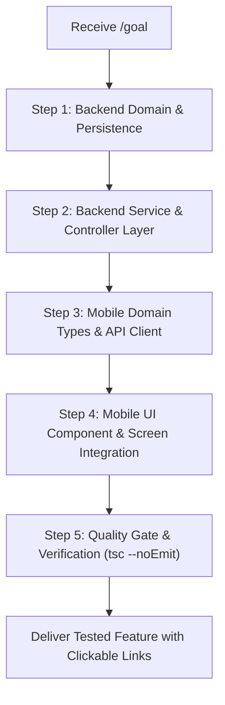

# 🚀 SKILL: ORBIT FEATURE BUILDER
## Autonomous Fullstack Pipeline for Goal-Driven Feature Engineering

This skill equips the AI Agent to autonomously engineer and deliver features across both the **Spring Boot 3** backend and **React Native** mobile client upon receiving a `/goal` instruction, maintaining zero regression and strict adherence to ADHD cognitive ergonomics.

---

## 1. PRE-FLIGHT CHECKLIST (BEFORE WRITING CODE)

Before generating or editing code, the agent MUST verify:
1. **Invariant Check:** Does this feature violate **WIP = 1** or introduce any red elements (`#FF0000`)? If yes, adjust the UX design immediately.
2. **Read System Specifications:**
   - Consult [docs/code-standards.md](../../../docs/code-standards.md) for feature layout rules.
   - Consult [docs/codebase-summary.md](../../../docs/codebase-summary.md) for existing state owners and endpoint registries.
3. **Surgical Scope Definition:** Identify the exact list of files to create or modify. Do not touch unrelated modules.

---

## 2. STEP-BY-STEP IMPLEMENTATION PIPELINE



### Step 1: Backend Domain & Persistence
1. If the feature requires database persistence, create or update the JPA entity in `backend/src/main/java/com/orbit/entity/`.
2. Define the Spring Data JPA repository interface in `backend/src/main/java/com/orbit/repository/`.
3. Create immutable DTO records with Jakarta Bean Validation (`@NotBlank`, `@Size`, `@Min`, `@Max`) in `backend/src/main/java/com/orbit/dto/`.

### Step 2: Backend Service & REST Controller
1. Define the service interface in `backend/src/main/java/com/orbit/service/`.
2. Implement business logic with `@Transactional` boundaries in `backend/src/main/java/com/orbit/service/impl/`.
   - Read queries: `@Transactional(readOnly = true)`.
   - Modifying queries: `@Transactional(rollbackFor = Exception.class)`.
3. Expose REST endpoints under `/api/v1/...` in `backend/src/main/java/com/orbit/controller/`.
   - Controller must only receive `@Valid` DTOs and return `ResponseEntity<ApiResponse<T>>`.

### Step 3: Mobile Domain Types & API Integration
1. Update `mobile/src/types/index.ts` to export TypeScript types/interfaces corresponding to backend DTOs.
2. Add API methods with Axios in `mobile/src/services/api.ts`.
3. If shared cross-component state is needed, integrate with Zustand in `mobile/src/store/`.

### Step 4: Mobile Presentation Components
1. Implement UI widgets in `mobile/src/components/`.
   - **Enforce Touch Target:** `minHeight: 44, minWidth: 44`.
   - **Enforce Calm Dark Tokens:** Canvas `#0F172A`, Card `#1E293B`, Border `#334155`, Accent `#38BDF8`.
   - **Enforce No Red Rule:** Warnings must use Sand Amber `#FBBF24` or Soft Coral `#F87171`.
2. Integrate into the appropriate screen in `mobile/src/screens/` or `mobile/App.tsx`.

---

## 3. VERIFICATION & SELF-HEALING GATE

After code changes, the agent MUST run verification commands:

```bash
# Verify Mobile TypeScript compilation:
node ./mobile/node_modules/typescript/bin/tsc --noEmit -p mobile/tsconfig.json
```

* **If type errors occur:** The agent must inspect the error output, perform surgical fixes on the offending lines, and re-run verification until 0 errors are achieved.
* **Never suppress errors with `@ts-ignore` or `any` casting.**

---

## 4. EXAMPLE USAGE

### Example Goal Prompt:
```text
/goal Thêm tính năng gắn nhãn danh mục (Category Tag) cho Task:
- Backend: Cập nhật Entity Task, thêm trường categoryTag (max 50 ký tự), cập nhật DTO và Service.
- Mobile: Thêm chip hiển thị CategoryTag trên TaskCard với nền mờ và touch target 44pt.
- Chạy kiểm tra tsc --noEmit đảm bảo không có lỗi type.
```
