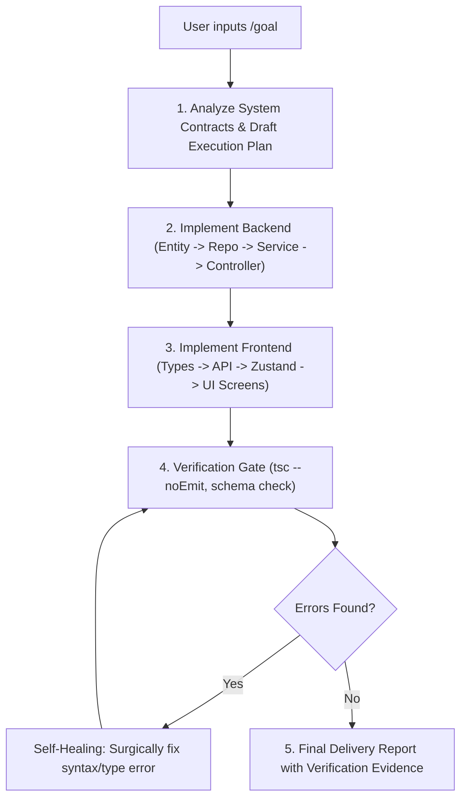

# 🌌 AGENTS.md — ORBIT WORKSPACE AGENT BLUEPRINT
## Intelligent Task Orchestrator for ADHD Minds

> This document is the master instruction file for AI coding agents (Antigravity, Codex, Cursor, Claude Code) operating in this repository. It establishes architectural invariants, cognitive ergonomics, coding boundaries, and the `/goal` autonomous execution protocol.

---

## 1. PROJECT OVERVIEW

- **Project Name:** Orbit
- **Mission:** Cognitive orthotic & task orchestration system engineered specifically for individuals with **Attention Deficit Hyperactivity Disorder (ADHD)** and **Executive Dysfunction** (Analysis Paralysis, Time Blindness, Working Memory Decay).
- **Core Stacks:**
  - **Backend:** Spring Boot 3.x (Java 17/21), Spring Data JPA, Spring AI, PostgreSQL 15, Spring Security 6 + JWT.
  - **Mobile Client:** React Native (Expo SDK 51), TypeScript, Zustand, TanStack Query, React Native Reanimated.
  - **AI Engine:** Google Gemini 1.5 Flash via Spring AI (JSON Structured Output Mode).

---

## 2. DEVELOPMENT PRINCIPLES & KARPATHY GUIDELINES

Every agent working on this codebase MUST adhere strictly to the following engineering axioms:

1. **Think Before Coding:** Fully inspect existing contracts, entities, and open documents before generating code. State architectural assumptions clearly.
2. **Surgical Edits Only:** Make minimal, focused edits. Touch ONLY the lines and files required for the requested feature or fix. Never reformat, reorder, or rewrite unrelated code.
3. **YAGNI (You Aren't Gonna Need It):** Avoid speculative abstractions, premature caching layers, or unnecessary helper hierarchies.
4. **KISS (Keep It Simple, Stupid):** Prefer simple, readable, idiomatic solutions over complex metaprogramming or obscure design patterns.
5. **DRY (Don't Repeat Yourself):** Consolidate shared business logic in service layers (Backend) and reusable hooks/components (Mobile).
6. **Verifiable Success Criteria:** Every task must define verifiable criteria before code changes (e.g., TypeScript compiler pass `tsc --noEmit` with 0 errors, backend compilation, schema validation).

---

## 3. CODING AGENT HARD RULES (RÀNG BUỘC BẤT BIẾN)

### 3.1. ADHD Cognitive Ergonomics (Frontend / Mobile)
* ⛔ **STRICT PROHIBITION: NEVER USE PANIC RED (`#FF0000`, `#EF4444`, `red`):**
  - Bright red triggers **Rejection Sensitive Dysphoria (RSD)** in ADHD minds, leading to anxiety and app abandonment.
  - Use Sand Amber `#FBBF24` for warnings and Soft Coral `#F87171` for high cognitive energy.
  - Never display alarmist text like *"OVERDUE / TRỄ HẠN!"*. Use gentle phrasing: *"Việc này đã qua ngày dự kiến — bạn có thể điều chỉnh lại khi sẵn sàng."*
* 🎨 **Calm Dark Scheme Invariant:** Canvas `#0F172A` (Slate-900), Card `#1E293B` (Slate-800), Border `#334155` (Slate-700), Accent Sky Blue `#38BDF8`.
* 🎯 **Single-Task Prominence & WIP Limit = 1:** The `DOING` column allows strictly **ONE** active task. If a second task is moved into `DOING`, apply spring physics rollback and a supportive toast notice.
* 🛡️ **Gentle Streak Protection:** Always honor the 2-credit **Streak Freeze Shield** (`color.badge.freeze: #818CF8`) to forgive missed days.
* 👆 **Minimum Touch Target:** All interactive controls (buttons, checkboxes, chips) must be $\ge 44 \times 44\text{ pt}$ with $\ge 8\text{px}$ padding separation.

### 3.2. Clean Architecture & Security (Backend)
* 🏛️ **Inward Dependency Rule:** `Controller -> Service -> Repository -> Entity`.
  - Controllers only handle HTTP routing, DTO validation (`@Valid`), and response encapsulation (`ResponseEntity<ApiResponse<T>>`).
  - Business logic resides strictly in `@Service` classes with explicit `@Transactional`.
  - Never return JPA entities directly over the wire; always map to DTOs.
* 🛡️ **Centralized Error Masking:** All exceptions must pass through `@RestControllerAdvice` (`GlobalExceptionHandler`). Never expose internal SQL traces or stack traces to clients.
* ⏱️ **AI Timeout & Fallback (Edge Case 01 & 12):** Spring AI calls to Gemini must enforce a 3000ms timeout. On timeout or failure, activate the Heuristic Fallback Engine with `"isFallback": true`.
* 🧩 **Micro-Step Constraints:** Subtasks generated by AI must be capped at $\le 20\text{ minutes}$, with step 1 strictly $< 5\text{ minutes}$.

---

## 4. GOAL-DRIVEN AUTONOMOUS PROTOCOL (`/goal`)

When the user initiates a request with `/goal`, the AI Agent operates in **autonomous multi-step execution mode**:

### Protocol Guidelines for `/goal`:
1. Do not ask for confirmation on micro-steps; proceed autonomously through the full implementation pipeline.
2. Execute the verification command (e.g. `node ./node_modules/typescript/bin/tsc --noEmit` in `mobile/`) and self-correct any issues.
3. Present the final output with clickable file links, commit summary, and testing evidence.

---

## 5. SKILLS & RULES DIRECTORY CATALOG

Custom workspace procedures reside in `.agents/`:

| Path | Type | Purpose |
| :--- | :--- | :--- |
| [`.agents/rules/backend_clean_architecture.md`](.agents/rules/backend_clean_architecture.md) | Always-On Rule | Spring Boot 3 Clean Architecture, DTO validation, security & error formatting. |
| [`.agents/rules/adhd_cognitive_ux_rules.md`](.agents/rules/adhd_cognitive_ux_rules.md) | Always-On Rule | Calm dark scheme, prohibition of red alerts, WIP=1, WCAG 2.1 AA touch targets. |
| [`.agents/skills/ai-task-decomposer/SKILL.md`](.agents/skills/ai-task-decomposer/SKILL.md) | On-Demand Skill | Gemini 1.5 Flash task breakdown, <20m constraint, JSON schema & heuristic fallback. |
| [`.agents/skills/adhd-ui-evaluator/SKILL.md`](.agents/skills/adhd-ui-evaluator/SKILL.md) | On-Demand Skill | 4-step WCAG 2.1 AA audit, contrast checker, haptics latency & UI edge state testing. |
| [`.agents/skills/orbit-feature-builder/SKILL.md`](.agents/skills/orbit-feature-builder/SKILL.md) | On-Demand Skill | Autonomous end-to-end feature pipeline across Spring Boot and React Native. |

---

## 6. KEY DOCUMENTATION REFERENCES

Before starting work, reference the following specifications:
- 📖 [Code Standards Guide](docs/code-standards.md) — Feature layouts & component structure.
- 🗺️ [Codebase Summary](docs/codebase-summary.md) — System identity, state owners, and endpoint map.
- 📋 [Product Requirements Document (PRD)](docs/prd/02_PRD.md) — 12 edge cases & domain model specs.
- 🏗️ [System Architecture](docs/architecture/01_SYSTEM_ARCHITECTURE.md) — Layered diagrams & database ERD.
- 🎨 [UI Wireframes & Prototype](docs/design/02_WIREFRAMES_AND_PROTOTYPE.md) — Design tokens & 8-screen wireframes.
