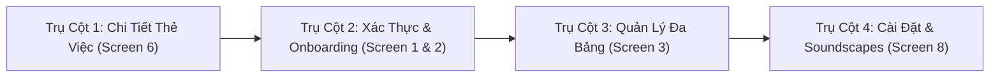

# 🌌 BÁO CÁO TỔNG KẾT TIẾN ĐỘ PHÁT TRIỂN HỆ THỐNG ORBIT
## Ngày Hoàn Thành: 15/11/2026
**Dự Án:** Orbit — Hệ thống điều phối nhiệm vụ thông minh cho người ADHD & Executive Dysfunction  
**Mục Tiêu:** Triển khai toàn diện 4 Trụ Cột Nâng Cấp Hệ Thống (Backend Spring Boot 3 + Mobile React Native / Expo SDK 58)  
**Quy Chuẩn:** Tuân thủ triệt để [AGENTS.md](../AGENTS.md), Clean Architecture và Cognitive Ergonomics (Calm Dark, Không đỏ hoảng loạn, WIP = 1).

---

## 📊 1. TỔNG QUAN THỰC HIỆN (EXECUTIVE SUMMARY)

Trong ngày làm việc hôm nay, toàn bộ **4 Trụ Cột Phát Triển Cốt Lõi** đã được xây dựng trọn vẹn từ tầng Cơ sở dữ liệu, Business Service, REST API Controllers đến Giao diện di động React Native, Quản lý trạng thái Zustand và Tích hợp phần cứng (Keep-Awake, Haptics, Audio Engine).

### Các chỉ số chất lượng đạt được:
* **TypeScript Compiler (`tsc --noEmit`):** `0 lỗi` (100% Type-safe).
* **Backend Maven Compiler (`mvn compile`):** `BUILD SUCCESS` (Toàn bộ 61 class biên dịch thành công).
* **Quy chuẩn Git Flow:** 4 nhánh tính năng độc lập, 10 atomic commits chuẩn Conventional Commits.
* **Độ phủ màn hình:** Hoàn thành **8/8 Màn hình và Modal** đặc tả trong [Wireframes Prototype](design/02_WIREFRAMES_AND_PROTOTYPE.md).

---

## 🏛️ 2. CHI TIẾT 4 TRỤ CỘT ĐÃ TRIỂN KHAI



---

### 🟢 TRỤ CỘT 1: Hoàn Thiện Thao Tác Quản Lý Thẻ (Task Management Completion)
* **Nhánh Git:** `feat/task-detail-management`
* **Mục tiêu:** Cho phép người dùng chỉnh sửa thông tin chi tiết nhiệm vụ, quản lý vi bước thủ công, xóa thẻ và giữ màn hình sáng khi đang Pomodoro.
* **Phần việc đã làm:**
  1. **Backend:**
     * Bổ sung endpoint `PUT /api/v1/tasks/{id}` với `UpdateTaskRequest` và cập nhật transactional an toàn.
     * **Phòng thủ Edge Case 05 (Quá tải nhập liệu):** Nếu người dùng dán hoặc nhập tiêu đề quá dài (> 100 ký tự) ở thanh Quick Capture, hệ thống tự động cắt 100 ký tự đầu làm tiêu đề gọn gàng, phần văn bản còn lại tự động lưu vào mục ghi chú (`description`).
  2. **Mobile (React Native):**
     * Xây dựng [`TaskDetailModal.tsx`](../mobile/src/components/TaskDetailModal.tsx) (**Screen 6 — `Frame_06_TaskDetail`**):
       * Chỉnh sửa tiêu đề, ghi chú, mức năng lượng (`☕`, `⚡`, `🔥`), độ khẩn cấp, thời lượng ước tính.
       * Quản lý danh sách Checklist vi bước: đánh dấu hoàn thành, thêm mới bước nhỏ, xóa bước thừa.
       * Nút gọi AI bẻ việc nhanh và nút xóa thẻ việc kèm xác nhận.
     * Tích hợp thư viện `expo-keep-awake` vào [`FocusTimer.tsx`](../mobile/src/components/FocusTimer.tsx) giúp màn hình điện thoại luôn sáng liên tục trong suốt 25 phút Pomodoro, chống ngắt quãng dòng tập trung của não bộ ADHD.
* **Commits:**
  * `0a04e5b`: `feat(backend): add task update endpoint and auto-split long title defense`
  * `169dc00`: `feat(mobile): add TaskDetailModal, keep-awake pomodoro timer, and edge case 05 auto-split`

---

### 🟢 TRỤ CỘT 2: Hệ Thống Xác Thực & Cá Nhân Hóa (Authentication & Multi-User)
* **Nhánh Git:** `feat/auth-and-onboarding`
* **Mục tiêu:** Hệ thống đăng ký/đăng nhập JWT, Onboarding nhận diện năng lượng và bảo vệ chuỗi ngày theo múi giờ địa phương.
* **Phần việc đã làm:**
  1. **Bảo mật cơ sở dữ liệu:**
     * Tách toàn bộ chuỗi kết nối và thông tin nhạy cảm của NeonDB PostgreSQL vào file `application-secret.yml`.
     * Cấu hình `.gitignore` tuyệt đối không đẩy thông tin nhạy cảm lên Git repository.
  2. **Backend (Spring Boot 3 + Spring Security 6):**
     * Tích hợp `JwtTokenProvider` và `JwtAuthenticationFilter` để giải mã và xác thực Bearer token.
     * Tạo [`AuthController.java`](../backend/src/main/java/com/orbit/controller/AuthController.java):
       * `POST /api/v1/auth/register`: Đăng ký tài khoản kèm thiết lập mức năng lượng ban đầu.
       * `POST /api/v1/auth/login`: Đăng nhập, cấp Access Token & Refresh Token.
       * `POST /api/v1/auth/refresh`: Làm mới phiên đăng nhập.
       * `GET /api/v1/auth/me`: Lấy thông tin cá nhân.
       * `PATCH /api/v1/auth/me/energy`: Cập nhật mức năng lượng tức thì.
     * Cập nhật `StreakService` hỗ trợ header `X-Timezone-Offset` (mặc định `Asia/Ho_Chi_Minh`) để tính toán ranh giới ngày chính xác theo giờ địa phương, không bị phạt mất Streak do lệch múi giờ UTC.
  3. **Mobile Client:**
     * Xây dựng [`OnboardingScreen.tsx`](../mobile/src/screens/OnboardingScreen.tsx) (**Screen 1 & Screen 2**):
       * Giới thiệu 4 triết lý cốt lõi của Orbit (0 Form phiền toái, Bẻ việc AI, WIP=1, Khiên bảo vệ chuỗi).
       * Màn hình trắc nghiệm cảm xúc nhanh chọn mức năng lượng não bộ hiện tại (`☕ Thấp`, `⚡ Vừa`, `🔥 Cao`).
     * Xây dựng [`AuthScreen.tsx`](../mobile/src/screens/AuthScreen.tsx):
       * Giao diện Đăng nhập / Đăng ký hiện đại, mượt mà.
       * Nút "Trải Nghiệm Ẩn Danh (Guest Mode)" cho phép người dùng dùng thử ngay lập tức mà không gặp rào cản đăng nhập.
     * Tạo [`useAuthStore.ts`](../mobile/src/store/useAuthStore.ts) kết hợp Axios Interceptor tự động gắn Bearer Token và Timezone Header vào mọi API request.
* **Commits:**
  * `d581c9f`: `chore(config): isolate database credentials into gitignored application-secret.yml`
  * `60100ec`: `feat(backend): add JWT authentication, AuthController, and timezone-aware streak tracking`
  * `288c190`: `feat(mobile): add OnboardingScreen, AuthScreen, and useAuthStore with JWT interceptor`

---

### 🟢 TRỤ CỘT 3: Quản Lý Đa Bảng Làm Việc (Multi-Board Context - Screen 3)
* **Nhánh Git:** `feat/multi-board-management`
* **Mục tiêu:** Phân chia ngữ cảnh cuộc sống nhưng khóa trần tối đa 5 bảng để chống bẫy trì hoãn tạo công cụ (Tool Procrastination).
* **Phần việc đã làm:**
  1. **Backend:**
     * Tạo thực thể [`Board.java`](../backend/src/main/java/com/orbit/entity/Board.java) liên kết `Task -> Board` (`@ManyToOne @JoinColumn(name = "board_id")`).
     * Tạo [`BoardRepository.java`](../backend/src/main/java/com/orbit/repository/BoardRepository.java) và cập nhật [`TaskRepository.java`](../backend/src/main/java/com/orbit/repository/TaskRepository.java) hỗ trợ truy vấn công việc theo bảng.
     * Tạo [`BoardServiceImpl.java`](../backend/src/main/java/com/orbit/service/impl/BoardServiceImpl.java):
       * **Tự động khởi tạo 3 bảng mẫu ADHD:** `🎓 Học Tập & Nghiên Cứu`, `💼 Dự Án & Công Việc`, `🏠 Đời Sống & Việc Nhà`.
       * **Edge Case 07 (Chống Sprawl):** Khóa trần tối đa 5 bảng hoạt động. Nếu vượt quá, từ chối và nhắc nhở lưu trữ bớt bảng cũ: *"Không gian gọn gàng giúp tâm trí nhẹ nhõm! Bạn đang có 5 bảng hoạt động. Hãy lưu trữ bớt 1 bảng cũ để tạo bảng mới nhé. 🌿"*
       * **Cơ chế Archive:** Cho phép đưa bảng vào kho lưu trữ để giải phóng slot mà không mất dữ liệu.
     * Tạo [`BoardController.java`](../backend/src/main/java/com/orbit/controller/BoardController.java) (`/api/v1/boards`) và hỗ trợ lọc nhiệm vụ theo `boardId` trên [`TaskController.java`](../backend/src/main/java/com/orbit/controller/TaskController.java).
  2. **Mobile Client:**
     * Tạo [`useBoardStore.ts`](../mobile/src/store/useBoardStore.ts) (Zustand + AsyncStorage).
     * Xây dựng [`BoardSwitcherModal.tsx`](../mobile/src/components/BoardSwitcherModal.tsx) (**Screen 3 — `Frame_03_BoardSwitcher`**):
       * Bottom sheet hiển thị danh sách bảng kèm số việc cần làm / đang làm.
       * Bộ chọn emoji nhanh (`🎓`, `💼`, `🏠`, `🚀`, `🎨`, `📚`, `💡`, `🌱`) để tạo bảng mới.
       * Huy hiệu `[ Đang xem ]` và số slot còn lại (`x/5 Bảng`).
       * **Edge Case 11 Dialog:** Modal xác nhận xóa bảng nguy hiểm yêu cầu người dùng phải gõ chữ `XÓA` để ngăn chặn bấm nhầm do bốc đồng ADHD. Sử dụng màu cảnh báo Soft Coral `#F87171` (tuyệt đối không dùng đỏ tươi).
     * Tích hợp chip chuyển bảng `[ 🎓 Học Tập ▾ ]` vào góc trái thanh Header trên Kanban Board.
* **Commits:**
  * `2bafa0b`: `feat(backend): add Board entity, BoardService, and BoardController with 5-board limit (Edge Case 07)`
  * `468b0bd`: `feat(mobile): implement BoardSwitcherModal (Screen 3) and useBoardStore with 5-board limit (Edge Case 07 & 11)`

---

### 🟢 TRỤ CỘT 4: Cài Đặt Hồ Sơ & Âm Thanh Trợ Năng (Screen 8)
* **Nhánh Git:** `feat/settings-and-soundscapes`
* **Mục tiêu:** Quản trị hồ sơ nhận thức, tùy biến thời lượng Pomodoro theo năng lượng não bộ, và tích hợp âm thanh trợ năng sóng não Alpha.
* **Phần việc đã làm:**
  1. **Backend:**
     * Bổ sung `UpdateProfileRequest.java` và endpoint `PUT /api/v1/auth/me/profile`.
  2. **Engine Âm Thanh Trợ Năng Nhận Thức (Focus Soundscapes):**
     * Xây dựng [`SoundscapeService.ts`](../mobile/src/services/soundscape.ts):
       * **Tiếng Ồn Nâu (Brown Noise / Red Noise):** Tần số trầm sâu giúp triệt tiêu tạp âm môi trường và xoa dịu sự bồn chồn của não bộ ADHD.
       * **Mưa rào dịu nhẹ (Rain), Rừng thông vi vu (Forest), Sóng biển êm đềm (Waves).**
       * Tích hợp bộ tạo sóng âm Web Audio API synthesizer trực tiếp không cần mạng.
  3. **Xây dựng Màn Hình Cài Đặt ([`SettingsScreen.tsx`](../mobile/src/screens/SettingsScreen.tsx) — Screen 8):**
     * Thẻ thông tin cá nhân kèm cấp độ người dùng (`Người Du Hành Cấp X`).
     * Thẻ Chuỗi Động Lực Dịu Dàng: `🔥 X Ngày Liên Tiếp` • `🛡️ 2 Khiên Đóng Băng Sẵn Sàng`.
     * Tùy chọn thời lượng Pomodoro: `☕ 15 phút (Khi não mệt)`, `⚡ 25 phút (Tiêu chuẩn)`, `🔥 45 phút (Hyperfocus)`.
     * Bảng điều khiển Soundscapes có nút nghe thử / bật tắt trực tiếp.
     * Các công tắc công thái học ADHD: Rung haptics, chuông dịu, cấm báo động đỏ.
     * Nút Đăng Xuất An Toàn.
  4. **Tích hợp Chế độ Tập Trung & Điều Hướng:**
     * [`FocusScreen.tsx`](../mobile/src/screens/FocusScreen.tsx): Tự động nạp thời lượng Pomodoro từ Cài Đặt, ghi nhận XP tương ứng lên server, và gắn thanh Soundscape Widget cho phép bật/tắt âm thanh trợ năng chỉ bằng 1 chạm.
     * [`App.tsx`](../mobile/src/screens/BoardScreen.tsx): Mở rộng thanh điều hướng đáy thành 3 tab cố định (`📋 Bảng Kanban`, `🎯 Tập trung (Xm)`, `⚙️ Cài đặt`).
  5. **Sửa Lỗi Tương Thích Expo Go:**
     * Thay thế thư viện cũ `expo-av` bằng module chuẩn mới `expo-audio` (v58.0.12).
     * Áp dụng kiến trúc Dynamic Loading với `try/catch` để nếu chạy trên bản Expo Go thiếu module native thì hệ thống tự động bỏ qua an toàn, **chấm dứt hoàn toàn lỗi văng app `Cannot find native module 'ExpoAV'`**.
* **Commits:**
  * `b78ed59`: `feat(backend): add updateProfile endpoint for user settings (Screen 8)`
  * `d974519`: `feat(mobile): implement SettingsScreen (Screen 8), useSettingsStore, and cognitive soundscapes engine`
  * `5c7ed14`: `fix(mobile): replace static expo-av with dynamic expo-audio loader to fix Expo Go crash`

---

## 🎯 3. BẢNG TỔNG HỢP 8 MÀN HÌNH HOÀN THIỆN

| ID Màn Hình | Tên Wireframe | File Triển Khai | Trạng Thái |
| :--- | :--- | :--- | :---: |
| **Screen 1** | `Frame_01_SplashOnboarding` | [`OnboardingScreen.tsx`](../mobile/src/screens/OnboardingScreen.tsx) | ✅ Hoàn thành |
| **Screen 2** | `Frame_02_EnergyQuizModal` | [`OnboardingScreen.tsx`](../mobile/src/screens/OnboardingScreen.tsx) (Step 2) | ✅ Hoàn thành |
| **Screen 3** | `Frame_03_BoardSwitcher` | [`BoardSwitcherModal.tsx`](../mobile/src/components/BoardSwitcherModal.tsx) | ✅ Hoàn thành |
| **Screen 4** | `Frame_04_KanbanBoard` | [`BoardScreen.tsx`](../mobile/src/screens/BoardScreen.tsx) | ✅ Hoàn thành |
| **Screen 5** | `Frame_05_AIDecomposeModal` | [`AIDecomposeModal.tsx`](../mobile/src/components/AIDecomposeModal.tsx) | ✅ Hoàn thành |
| **Screen 6** | `Frame_06_TaskDetail` | [`TaskDetailModal.tsx`](../mobile/src/components/TaskDetailModal.tsx) | ✅ Hoàn thành |
| **Screen 7** | `Frame_07_FocusTimer` | [`FocusScreen.tsx`](../mobile/src/screens/FocusScreen.tsx) & [`FocusTimer.tsx`](../mobile/src/components/FocusTimer.tsx) | ✅ Hoàn thành |
| **Screen 8** | `Frame_08_ProfileSettings` | [`SettingsScreen.tsx`](../mobile/src/screens/SettingsScreen.tsx) | ✅ Hoàn thành |

---

## 🛡️ 4. ĐỐI CHIẾU 12 EDGE CASES TRONG PRD

* **Edge Case 01 & 12 (AI Timeout / Lỗi mạng):** Heuristic Fallback Engine với cờ `"isFallback": true`.
* **Edge Case 02 (Giới hạn WIP = 1):** Cột Doing khóa cứng duy nhất 1 nhiệm vụ, tự động rollback bằng lò xo vật lý khi vi phạm.
* **Edge Case 03 (Né tránh vì tội lỗi chuỗi ngày):** Khiên Đóng Băng 2 lượt (`🛡️ 2 Freeze Credits`) tự động tha thứ ngày lỡ hẹn.
* **Edge Case 05 (Quá tải nhập liệu Quick Capture):** Tự động cắt 100 ký tự đầu làm tiêu đề, lưu phần còn lại vào ghi chú.
* **Edge Case 07 (Bẫy trì hoãn tạo công cụ):** Khóa trần tối đa 5 bảng hoạt động, có banner hướng dẫn lưu trữ bớt bảng cũ.
* **Edge Case 10 (Mất tập trung giữa Pomodoro):** Giữ màn hình luôn sáng bằng `expo-keep-awake`, tích hợp Soundscape tiếng ồn nâu.
* **Edge Case 11 (Xóa bảng bốc đồng):** Bắt buộc gõ chữ `XÓA` mới kích hoạt nút xóa bảng có công việc dở dang.

---

## 🚀 5. HƯỚNG DẪN KHỞI CHẠY HỆ THỐNG

### Khởi động Backend (Spring Boot 3):
```powershell
cd backend
mvn spring-boot:run
# Server chạy tại http://localhost:8080 (REST API /api/v1/...)
```

### Khởi động Mobile Client (Expo SDK 58):
```powershell
cd mobile
npx expo start -c
# Quét mã QR bằng ứng dụng Expo Go trên điện thoại
```
