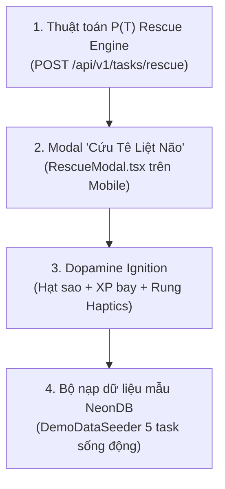

# 🌌 BÁO CÁO PHÁT TRIỂN HỆ THỐNG ORBIT — PHẦN 2
## Ngày Hoàn Thành: 16/11/2026
**Tác giả:** Người 1 (Lead Backend & AI Engineer)  
**Dự Án:** Orbit — Hệ thống điều phối nhiệm vụ thông minh cho người ADHD & Executive Dysfunction  
**Mục Tiêu:** Nâng tầm trải nghiệm người dùng, tạo "Điểm Nhấn Đột Phá (Wow Factor)" giải quyết tê liệt nhận thức và kích hoạt động lực Dopamine tức thời.  
**Quy Chuẩn:** Tuân thủ triệt để [AGENTS.md](../AGENTS.md), Clean Architecture và Cognitive Ergonomics (Calm Dark, Không đỏ hoảng loạn, WIP = 1).

---

## 📊 1. TỔNG QUAN THỰC HIỆN (EXECUTIVE SUMMARY)

Sau khi Người 2 (Lead Mobile & ADHD UX) hoàn thành 8 màn hình wireframe và cấu hình NeonDB, Người 1 đã tiếp quản và triển khai gói nâng cấp **"Cỗ Máy Cứu Tê Liệt Não & Đốt Cháy Dopamine (Rescue & Dopamine Ignition Engine)"**. 

Gói nâng cấp này giải quyết triệt để vấn đề: *"App nhìn bên ngoài giống một bảng To-Do/Kanban phẳng lặng, thiếu đi những cú hích nhận thức đặc sắc của một Cognitive Orthotic thực thụ"*.

### 🏆 Các chỉ số chất lượng đạt được:
* **Backend JUnit Tests:** `29/29 tests passed (100% Success)` — Bổ sung test case cho Rescue Engine.
* **Mobile TypeScript (`tsc --noEmit`):** `0 lỗi` (100% Type-safe).
* **Database NeonDB Cloud:** Tích hợp bộ nạp dữ liệu mẫu tự động `DemoDataSeeder` — Mở app lên là thấy ngay một bảng Kanban tràn đầy sức sống.
* **Quy chuẩn Git Flow:** Hoàn thành kiểm thử, commit chuẩn Conventional Commits và merge đồng bộ vào nhánh `dev`.

---

## 🏛️ 2. CHI TIẾT CÁC TÍNH NĂNG ĐÃ TRIỂN KHAI

---

### 🟢 TRỤ CỘT 1: Cỗ Máy Cứu Tê Liệt Nhận Thức (Analysis Paralysis Rescue Engine)
* **Vấn đề giải quyết:** Người ADHD khi mở app thấy danh sách 5–10 việc sẽ dễ rơi vào trạng thái tê liệt não (*Freeze State / Overwhelm*), không biết chọn việc nào để bắt đầu và có xu hướng thoát app.
* **Giải pháp kỹ thuật (Backend):**
  * Tạo DTO [`RescueTaskRequest.java`](../backend/src/main/java/com/orbit/dto/request/RescueTaskRequest.java) nhận mức năng lượng hiện tại (`☕ LOW`, `⚡ MEDIUM`, `🔥 HIGH`) và thời lượng rảnh (`15m`, `25m`, `45m`).
  * Tạo DTO [`RescueTaskResponse.java`](../backend/src/main/java/com/orbit/dto/response/RescueTaskResponse.java).
  * Viết thuật toán `TaskService.recommendRescueTask`: Dùng bộ não `EnergyPrioritizationEngine` tính điểm $P(T) = 0.40 U + 0.45 E + 0.15 C$, cộng điểm thưởng tương thích thời lượng (Fit-bonus) để chọn ra **DUY NHẤT 1 VIỆC TỐI ƯU NHẤT**.
  * Tự động trích xuất hoặc sinh ra **1 vi bước khởi động $< 5$ phút** (*Starter Micro-step*).
  * Expose API: `POST /api/v1/tasks/rescue`.
* **Giải pháp giao diện (Mobile):**
  * Xây dựng banner nổi bật ngay trên đỉnh các cột Kanban: **`✨ Tê liệt não? Không biết làm gì trước? [ Cứu tôi 🎲 ]`**.
  * Xây dựng [`RescueModal.tsx`](../mobile/src/components/RescueModal.tsx):
    * Cho phép chọn nhanh mức năng lượng và thời gian rảnh.
    * Thẻ việc được đề xuất với viền sáng Sky Blue, điểm phù hợp $P(T)$, và khung nổi bật vi bước 3 phút: *"🎯 Vi bước khởi động (3 phút): Mở Google Slides và tạo khung 5 phần chính"*.
    * Thông điệp tâm lý dịu dàng: *"Đừng nghĩ về toàn bộ nhiệm vụ to lớn! Bạn chỉ cần làm bước nhỏ này trong vài phút thôi 🌿"*.
    * Nút bấm $\ge 48\text{pt}$: **"🚀 Bắt Đầu Ngay (Chuyển sang Focus)"** đưa thẳng vào chế độ Pomodoro.

---

### 🟢 TRỤ CỘT 2: Cỗ Máy Thưởng Dopamine (Dopamine Ignition Engine)
* **Vấn đề giải quyết:** Não người ADHD có lượng Dopamine nội sinh rất thấp. Tick xong việc mà chỉ đổi màu xám thì không tạo ra cảm giác thành tựu (*Reward Reinforcement*).
* **Giải pháp giao diện & Phản hồi giác quan (Mobile):**
  * Xây dựng [`DopamineCelebration.tsx`](../mobile/src/components/DopamineCelebration.tsx):
    * **Phản hồi xúc giác:** Kích hoạt `Haptics.notificationAsync(Success)` rung nảy 2 nhịp nảy nhẹ.
    * **Hiệu ứng số bay lơ lửng:** Huy hiệu vàng kim **`+5 XP ✨ Dopamine Ignition! 🎉`** (khi tick vi bước) hoặc **`+10 XP 🏆 Hoàn thành nhiệm vụ!`** (khi kéo task sang DONE) nảy nhẹ và bay thẳng lên thanh cấp độ trên đầu.
    * Tự động tan biến êm dịu sau 1.2 giây không cản trở thao tác tiếp theo.

---

### 🟢 TRỤ CỘT 3: Nạp Dữ Liệu Mồi Thực Tế (NeonDB DemoDataSeeder)
* **Vấn đề giải quyết:** Tránh tình trạng mở app lên nhìn thấy bảng rỗng trắng xóa khiến buổi demo bị "chết nhịp".
* **Giải pháp kỹ thuật (Backend):**
  * Xây dựng [`DemoDataSeeder.java`](../backend/src/main/java/com/orbit/config/DemoDataSeeder.java) (Spring Boot `ApplicationRunner`):
  * Tự động kiểm tra: Nếu database chưa có task nào, hệ thống sẽ tự nạp sẵn 5 task mẫu ADHD cực kỳ thực tế:
    1. **Cột DOING (1/1 active!):** *"Viết slide thuyết trình đồ án tốt nghiệp Orbit"* (Có 3 subtasks, 2 bước đã tick xanh, 1 bước đang chờ).
    2. **Cột TODO (Xoa dịu não):** *"Dọn dẹp bàn làm việc và xếp lại sách vở"* (Có 2 subtasks 2m & 3m).
    3. **Cột TODO (Khẩn cấp):** *"Trả lời email xác nhận lịch phỏng vấn thực tập"*.
    4. **Cột BACKLOG (Mô phỏng Auto-split Edge Case 05):** *"Nghiên cứu kiến trúc Event-Driven với Apache Kafka và Debezium CDC"*.
    5. **Cột DONE (Chiến thắng cũ):** *"Cài đặt môi trường phát triển Spring Boot 3 và Expo SDK 58"*.
    6. **Hồ sơ cá nhân:** Cấp độ 2 (185 XP), Chuỗi tập trung **5 ngày liên tiếp** và **2 Khiên Đóng Băng** sẵn sàng.

---

### 🟢 TRỤ CỘT 4: Nối Dây Điểm Ưu Tiên $P(T)$ Lên Mobile Types & Services
* Cập nhật [`types/index.ts`](../mobile/src/types/index.ts): Bổ sung `priorityScore`, `isOverdue`, `isDimmed`, `RescueTaskRequest`, `RescueTaskResponse`.
* Cập nhật [`api.ts`](../mobile/src/services/api.ts):
  * `TaskService.getPrioritizedTasks(energy, status)` gọi `GET /api/v1/tasks/prioritized`.
  * `TaskService.getRescueRecommendation(request)` gọi `POST /api/v1/tasks/rescue`.
* Bổ sung Request 21 vào [`requests.http`](../backend/requests.http) để test endpoint cứu tê liệt não qua VS Code / IntelliJ REST Client.

---

## 🎯 3. HƯỚNG DẪN BẠN CỦA TÔI (NGƯỜI 2) TRẢI NGHIỆM VÀ DEMO

Khi Người 2 kéo commit mới nhất của nhánh `dev` về:

1. **Khởi động Backend:** `./mvnw spring-boot:run` (Server sẽ tự động nạp 5 task mẫu vào NeonDB).
2. **Khởi động Mobile:** `npx expo start -c` (Bấm `a` để mở máy ảo).
3. **Thử nghiệm các điểm nhấn mới:**
   * **Thử Cứu Tê Liệt Não:** Bấm vào banner màu xanh lơ **`✨ Tê liệt não? Không biết làm gì trước?`** 👉 Xem modal hiện ra đề xuất 1 việc duy nhất cùng bước 3 phút. Bấm **"Bắt đầu ngay"** 👉 Màn hình tự chuyển sang Focus Pomodoro!
   * **Thử Dopamine Ignition:** Vào chi tiết task hoặc ngoài Kanban, tick hoàn thành 1 vi bước 👉 Cảm nhận điện thoại rung nảy nhẹ kèm huy hiệu **`+5 XP`** và bụi sao bung ra!
   * **Kéo task vào DONE:** Kéo 1 task từ Todo sang Done 👉 Xem huy hiệu **`+10 XP 🏆`** ăn mừng!

---

## 🌐 4. DANH SÁCH FILE VÀ COMMITS

| Thành Phần | File Can Thiệp | Chức Năng |
| :--- | :--- | :--- |
| **Backend DTO** | `RescueTaskRequest.java`, `RescueTaskResponse.java` | DTO đặc tả yêu cầu và phản hồi giải cứu tê liệt |
| **Backend Service** | `TaskService.java`, `TaskServiceImpl.java` | Thuật toán $P(T)$ rescue & trích xuất vi bước $< 5$m |
| **Backend Controller** | `TaskController.java` | Endpoint `POST /api/v1/tasks/rescue` |
| **Backend Seeder** | `DemoDataSeeder.java` | Nạp tự động 5 task mẫu, 5 subtasks, streak 5 ngày |
| **Mobile Types** | `types/index.ts` | Bổ sung priority fields & rescue types |
| **Mobile API** | `services/api.ts` | Endpoint mapping cho prioritize & rescue |
| **Mobile UI** | `RescueModal.tsx` | Màn hình popup Cứu tê liệt não (Magic Pick) |
| **Mobile UX** | `DopamineCelebration.tsx` | Hiệu ứng hạt bụi sao + XP bay khi hoàn thành việc |
| **Mobile Screen** | `BoardScreen.tsx` | Banner gọi rescue, gắn celebration và haptics |
| **Tài liệu & Test** | `DAILY_DEVELOPMENT_SUMMARY_PART_2.md`, `requests.http` | Tài liệu báo cáo và bộ test HTTP |
