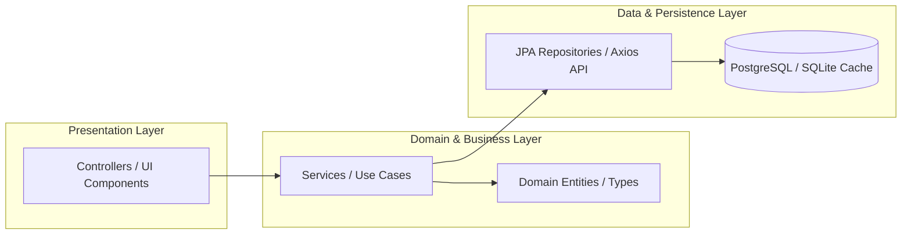

# 📐 CODE STANDARDS & ARCHITECTURAL GUIDELINES — ORBIT
## Enterprise Clean Architecture & React Native Engineering

| Metadata | Details |
| :--- | :--- |
| **Project** | **Orbit** — Intelligent Task Orchestrator for ADHD Minds |
| **Scope** | Backend (`backend/`) & Mobile Client (`mobile/`) |
| **Standards** | Clean Architecture (Martin), Karpathy Guidelines, WCAG 2.1 AA |
| **Target Audience** | Software Engineers & AI Coding Agents |

---

## 1. FEATURE & MODULE LAYOUT

### 1.1. Backend Feature Layout (Spring Boot 3)
```text
backend/src/main/java/com/orbit/
├── controller/                  # Presentation Layer: REST API Endpoints (/api/v1/...)
│   ├── TaskController.java
│   ├── BoardController.java
│   └── HealthController.java
├── service/                     # Business Logic Layer (Interface & Implementations)
│   ├── TaskService.java
│   ├── impl/
│   │   ├── TaskServiceImpl.java
│   │   └── AIServiceImpl.java
├── repository/                  # Persistence Layer (Spring Data JPA)
│   ├── TaskRepository.java
│   └── UserRepository.java
├── entity/                      # JPA Entities (Database Mapping)
│   ├── Task.java
│   ├── Subtask.java
│   └── User.java
├── dto/                         # Data Transfer Objects (Immutable Records)
│   ├── request/CreateTaskRequest.java
│   └── response/TaskResponse.java
├── exception/                   # Error Handling
│   ├── GlobalExceptionHandler.java
│   └── WipLimitExceededException.java
└── config/                      # Infrastructure & Security
    ├── SecurityConfig.java
    └── GeminiAIConfig.java
```

### 1.2. Mobile Feature Layout (React Native & Expo)
```text
mobile/src/
├── components/                  # Reusable UI Widgets (Pure / Presentation)
│   ├── TaskCard.tsx             # Kanban Task Card with WIP indicators
│   ├── QuickCaptureBar.tsx      # Sub-5s sticky bottom capture drawer
│   ├── AIDecomposeModal.tsx     # Human-in-the-loop breakdown bottom sheet
│   ├── EnergyFilterWidget.tsx   # Cognitive energy filter chips (☕/⚡/🔥)
│   └── FocusTimer.tsx           # Distraction-free Pomodoro countdown
├── screens/                     # Screen Containers & Route Boundary
│   ├── BoardScreen.tsx          # 4-column Kanban orchestration screen
│   └── FocusScreen.tsx          # Single-task Pomodoro isolation screen
├── services/                    # Network & API Integration
│   └── api.ts                   # Axios HTTP Client with JWT interceptor
├── store/                       # Reactive State Management (Zustand)
│   └── useTaskStore.ts          # Optimistic task cache & WIP limit guards
└── types/                       # TypeScript Domain Definitions
    └── index.ts                 # Task, Subtask, EnergyLevel, TaskStatus
```

---

## 2. INWARD DEPENDENCY RULE

Dependencies flow strictly inward toward the core domain model:



* **Backend Rule:** Controllers must never call Repositories directly. Services must never import Controller classes.
* **Mobile Rule:** Components must receive state via props or typed Zustand hooks. Never perform direct network calls inside JSX rendering blocks.

---

## 3. BACKEND CODING STANDARDS (SPRING BOOT 3)

1. **Immutable Records for DTOs:**
   - Always use Java `record` for DTOs (`CreateTaskRequest`, `SubtaskProposalDTO`).
   - Validate input with Jakarta Bean Validation (`@NotNull`, `@NotBlank`, `@Size`, `@Min`, `@Max`).
2. **Explicit Transaction Boundaries:**
   - Annotate service classes with `@Transactional(readOnly = true)` by default.
   - Annotate modifying methods (create, update, delete) with `@Transactional(rollbackFor = Exception.class)`.
3. **Constructor Injection:**
   - Never use field-level `@Autowired`. Use Lombok `@RequiredArgsConstructor` or explicit constructor injection to preserve immutability and testability.
4. **Resilient AI Calling Pattern:**
   - All external calls to Google Gemini 1.5 Flash must have a 3000ms timeout guard (`CompletableFuture.orTimeout` or Resilience4j).
   - If AI fails or times out, immediately fall back to the heuristic breakdown provider (Edge Case 01 & 12).
5. **No Stacktrace Leaks:**
   - Handle exceptions in `GlobalExceptionHandler` (`@RestControllerAdvice`).
   - Return clean, localized JSON error payloads with `ApiResponse<T>`.

---

## 4. MOBILE CODING STANDARDS (REACT NATIVE & TYPESCRIPT)

1. **TypeScript Strict Mode:**
   - Enforce 0 type errors (`node ./node_modules/typescript/bin/tsc --noEmit`).
   - Prohibit `any` types; define exhaustive union types for statuses (`TaskStatus: 'BACKLOG' | 'TODO' | 'DOING' | 'DONE'`).
2. **Design Tokens Invariance:**
   - Never hardcode raw hex values in components. Always map to design tokens:
     - `Canvas`: `#0F172A`
     - `Card`: `#1E293B`
     - `Border`: `#334155`
     - `Accent`: `#38BDF8`
     - `Energy`: Low `#94A3B8`, Med `#FBBF24`, High `#F87171` (Soft Coral)
   - **Hard Rule:** Red `#FF0000` is strictly forbidden across all stylesheets.
3. **Touch Target Accessibility:**
   - Every `TouchableOpacity` or `Pressable` must enforce `minHeight: 44, minWidth: 44` or use `hitSlop={{ top: 10, bottom: 10, left: 10, right: 10 }}`.
4. **Optimistic UI Updates:**
   - Instant capture actions (<5s) must immediately prepend task cards to local state before awaiting network response, providing instant dopamine confirmation.
5. **Spring Physics Consistency:**
   - Animated task transitions must use `{ damping: 15, stiffness: 120, mass: 1 }` for smooth, tangible haptic motion.

---

## 5. VERIFICATION GATE (ACCEPTANCE CRITERIA)

Before committing any feature or submitting a Pull Request:
* [ ] TypeScript compilation passes with zero errors: `npm run tsc` or `node ./node_modules/typescript/bin/tsc --noEmit`.
* [ ] Contrast ratio audits pass WCAG 2.1 AA ($\ge 4.5:1$ for text).
* [ ] WIP Limit invariant (Doing $\le 1$) is verified and unit-tested.
* [ ] No files outside the requested feature scope were altered (Karpathy surgical edit rule).
